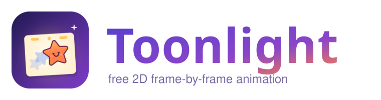
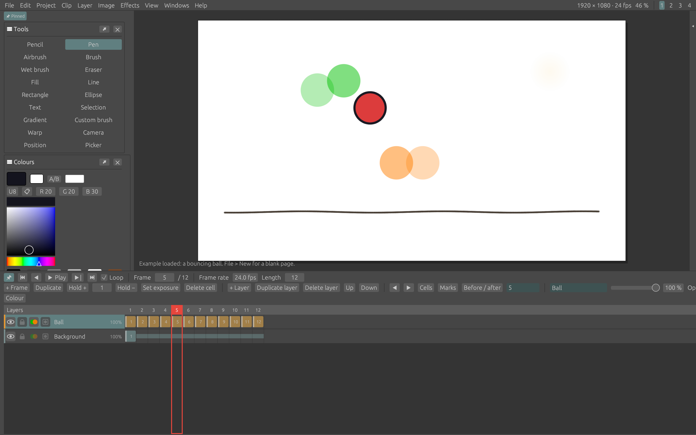

<p align="center">
  
</p>

<p align="center">
  Free and open-source 2D frame-by-frame animation software — bitmap drawing, layers, timeline,
  onion skin, camera, sound — for Windows, macOS and Linux. Written in Rust.
</p>

<p align="center">
  <a href="https://github.com/Cyril-vtn/toonlight/actions/workflows/ci.yml"></a>
  <a href="https://github.com/Cyril-vtn/toonlight/releases/latest"></a>
  <a href="LICENSE"></a>
</p>



## Download

Installers for every stable version are on the
**[Releases page](https://github.com/Cyril-vtn/toonlight/releases/latest)**:

| System | File | First start |
|---|---|---|
| Windows 10 / 11 | `Toonlight_x.y.z_x64-setup.exe` | Windows may show "Windows protected your PC": click **More info → Run anyway** (the installer is not signed yet). |
| macOS 11+ (Apple Silicon) | `Toonlight_x.y.z_aarch64.dmg` | Drag Toonlight to Applications. The first time, **right-click the app → Open** (it is not notarised yet). |
| Linux | `.AppImage` or `.deb` | `chmod +x Toonlight*.AppImage` then run it, or `sudo apt install ./toonlight_*.deb`. |

## Features

- **Drawing**: pencil (with grain), pen, airbrush, brush, wet brush (mixes colours), eraser, fill,
  line, rectangle, ellipse, text, gradient, warp, colour picker; size, power, opacity, aspect and
  angle; 17 draw modes (behind, shade, light, colorize, tint, multiply…); preserve transparency;
  line smoothing; pen pressure (tablets and touch screens), simulated from speed with a mouse.
- **Custom brushes** from a selection or a picture, and **tool presets**.
- **Selections**: rectangle, lasso, magic wand; copy, cut, paste; move, scale, rotate, mirror.
- **Layers**: visibility, lock, onion skin, stencil, opacity, blending modes, colour groups,
  before / after behaviours (none, repeat, ping-pong, hold).
- **Timeline**: cells and holds, several cells at once (move, copy, paste), exposures by a
  number, set exposure, drawing names, bookmarks, mark in / out, exposure sheet.
- **Light table** (onion skin), **flipping**, **view rotation and mirror**.
- **Animated camera**, **shots and storyboard**, **sound** with waveform and scrubbing.
- **Effects** with live preview: blur, mosaic, noise, wave, brightness / contrast,
  hue / saturation, invert, colour key, luma key.
- **Export**: PNG sequence, animated GIF, MP4 (with [FFmpeg](https://ffmpeg.org) installed), layer
  structure for After Effects.
- **Workspace**: panels you drag between columns or float, pinned or sliding columns, four rooms
  (workspaces) you can rename, export and import; keyboard shortcuts you can change, per room.
- **Languages**: English, French, Spanish, German, Simplified Chinese, Japanese.
- **AI control** through [MCP](https://modelcontextprotocol.io) (see below).

See [`CHANGELOG.md`](CHANGELOG.md) for what each version added and
[`docs/ROADMAP.md`](docs/ROADMAP.md) for what is planned.

## Building from source

You need [Rust](https://rustup.rs) (1.85 or later).

```sh
git clone https://github.com/Cyril-vtn/toonlight
cd toonlight
cargo run --release
```

On Linux, install the system libraries first (Debian / Ubuntu):

```sh
sudo apt install libgtk-3-dev libxkbcommon-dev libasound2-dev libxcb-render0-dev libxcb-shape0-dev libxcb-xfixes0-dev
```

Start options: `--lang en` (fr, en, es, de, zh, ja), `--shortcuts`, `--storyboard`,
`--screenshot shot.png` (draws about 120 frames, saves a picture and quits), `--mcp` (AI server,
no window), or a project file to open.

Installers are made with [cargo-packager](https://github.com/crabnebula-dev/cargo-packager):
`cargo install cargo-packager --locked`, then `cargo packager --release` (see
[`docs/RELEASING.md`](docs/RELEASING.md)).

## Driving it with an AI (MCP)

Toonlight is an MCP server: an AI assistant (Claude Desktop, Claude Code, Cursor, ChatGPT,
Continue, Zed…) can create projects (from templates), add, copy, merge and stack effects on layers,
draw strokes (with brush connections), shapes, text and gradients, fill, pick colours, edit the
palette, import pictures, picture sequences, videos and PSD files, set the timing and the exposure
sheet, the camera (with locks), the sound and the shots, look at a rendered frame and export
(pictures, GIF, MP4, PSD, After Effects, storyboard page, the whole film).

In the app, **Help > Connect an AI (MCP)…** shows the configuration to copy. By hand:

```json
{
  "mcpServers": {
    "toonlight": { "command": "/path/to/toonlight", "args": ["--mcp"] }
  }
}
```

Claude Code: `claude mcp add toonlight -- /path/to/toonlight --mcp`

**Live bridge**: while the Toonlight window is open, `toonlight --mcp` passes every command to it, so
the AI works on the project open on screen and each change can be undone there. With no window
open (or with `--mcp --standalone`), the AI works on its own project in memory. The bridge only
listens on this computer (127.0.0.1) and asks for a random code written in the settings folder.

## Default shortcuts

Change them in Edit > Preferences > Keyboard shortcuts.

| Key | Action |
|---|---|
| Enter | play / stop |
| ← → / ↑ ↓ | previous / next frame, layer above / below |
| [ ] | brush size |
| Space + drag, wheel | move, zoom the view |
| Ctrl/Cmd+Z, Ctrl/Cmd+Y | undo, redo |
| Ctrl/Cmd+S, Ctrl/Cmd+O | save, open |
| T | onion skin on / off |
| , . (hold) | flip to the previous / next drawing |
| Shift+← / Shift+→, Shift+H | rotate the view, mirror it |
| Alt+← / Alt+→ | move the selected cells |
| Shift+B, Shift+I, Shift+O | bookmark, mark in, mark out |
| N B A H W E G L R O K S D C Q M P I | tools |

## Artwork

The icon and the logo are original and drawn by code: `python3 tools/make_icon.py assets` redraws
every icon size and the Windows `.ico` (Python standard library only). `docs/logo.svg` is the
icon with the name. They are under the same MIT licence as the code.

## Contributing

Toonlight is a community project: anyone can help maintain it. See [`GOVERNANCE.md`](GOVERNANCE.md)
for how decisions are made. Contributions of all kinds are welcome — code, translations, bug reports, ideas. Read
[`CONTRIBUTING.md`](CONTRIBUTING.md) and the [code of conduct](CODE_OF_CONDUCT.md). Report security
problems privately as described in [`SECURITY.md`](SECURITY.md).

## Licence

Toonlight is released under the [MIT licence](LICENSE). Its dependencies have their own open-source
licences (MIT, Apache-2.0, BSD, ISC, zlib; the interface fonts that come with egui are under the
SIL Open Font Licence and the Ubuntu Font Licence).

Toonlight is an independent project. It contains no code, artwork or data from any other animation
program; product names mentioned by users or contributors belong to their owners.
